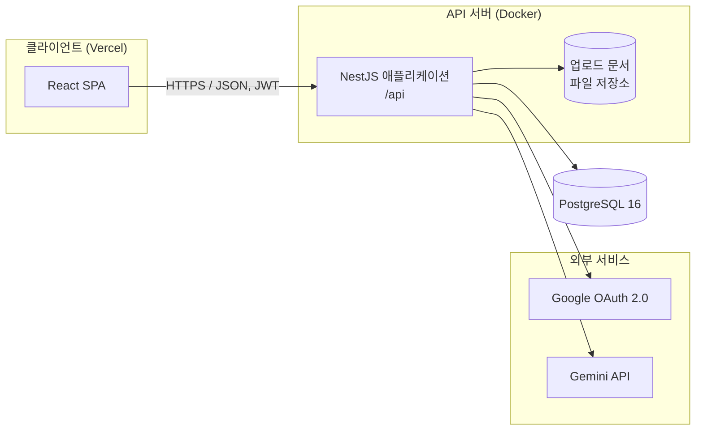
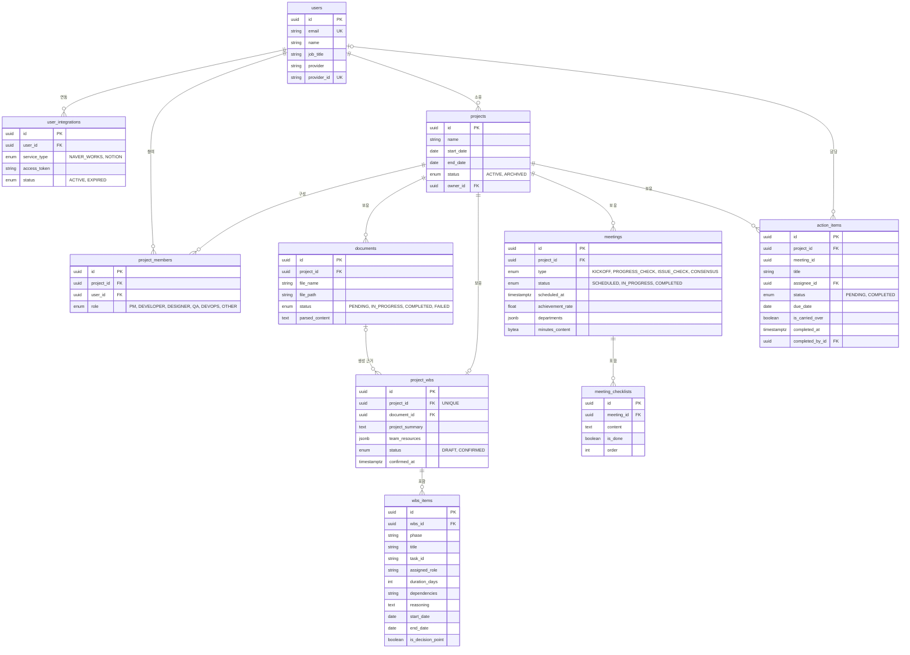
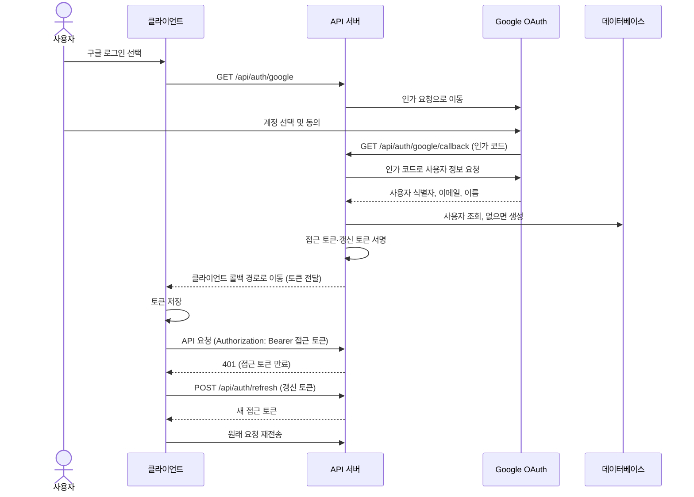

# 3. 시스템 설계

본 장에서는 컨펌 시스템의 설계를 기술한다. 먼저 PM의 업무 흐름에서 도출한 기능 요구사항과 비기능 요구사항을 정리하고, 이를 충족하기 위한 시스템 아키텍처와 기술 스택을 제시한다. 이어서 데이터베이스와 API의 설계를 설명하고, 마지막으로 인증과 접근 제어를 중심으로 보안 설계를 기술한다.

## 가. 요구사항 분석

본 절에서는 서비스 기획 단계에서 정의한 핵심 기능을 바탕으로 시스템의 요구사항을 기능 요구사항과 비기능 요구사항으로 나누어 기술한다. 각 요구사항에는 현재 구현 여부를 함께 표시하여 4장에서 다루는 구현 내용과의 대응 관계를 분명히 한다.

### 1) 기능 요구사항

컨펌의 기능 요구사항은 PM의 업무 흐름에 따라 계획 수립, 회의 운영, 일정 관리의 세 영역으로 나뉜다. 계획 수립 영역에서 PM은 수행계획서를 업로드하여 WBS 초안을 자동으로 받고, 이를 검토·수정한 뒤 확정한다. 회의 운영 영역에서는 확정된 WBS의 일정을 근거로 회의 일정을 추천받고, 회의 유형별 체크리스트로 회의를 진행하며, 회의에서 처리하지 못한 사항을 다음 회의로 넘긴다. 일정 관리 영역에서는 WBS 일정과 회의 일정을 한 화면에서 확인한다. 여기에 사용자 인증과 프로젝트·팀원 관리 같은 공통 기능이 더해진다. 도출한 기능 요구사항은 [표 2]와 같다.

[표 2] 기능 요구사항

| ID | 영역 | 요구사항 | 내용 | 구현 여부 |
|---|---|---|---|---|
| FR-01 | 공통 | 소셜 로그인 | 구글 계정으로 로그인하며, 최초 로그인 시 자동으로 가입한다 | 구현 |
| FR-02 | 공통 | 프로필 관리 | 이름, 직군 등 사용자 정보를 조회·수정한다 | 구현 |
| FR-03 | 공통 | 프로젝트 관리 | 프로젝트를 생성·조회·수정·삭제하고 진행 상태(진행 중, 보관)로 구분한다 | 구현 |
| FR-04 | 공통 | 팀원 관리 | 가입한 사용자를 이메일로 검색하여 팀원으로 등록하고 역할을 부여한다 | 구현 |
| FR-05 | 계획 수립 | 수행계획서 분석 | 수행계획서 PDF 파일을 업로드하면 텍스트를 추출하여 분석한다 | 구현 |
| FR-06 | 계획 수립 | WBS 자동 생성 | 분석 결과로부터 담당 부서, 기간, 선후행 관계, 산정 근거를 포함한 WBS 초안을 생성한다 | 구현 |
| FR-07 | 계획 수립 | WBS 검토·확정 | PM이 WBS 항목과 투입 인력 정보를 수정·삭제하고, 의사결정 지점을 지정한 뒤 최종 확정한다 | 구현 |
| FR-08 | 회의 운영 | 회의 일정 추천 | 확정된 WBS의 태스크 일정을 근거로 회의 일정을 추천하고 일괄 등록한다 | API만 구현 |
| FR-09 | 회의 운영 | 회의 관리 | 킥오프, 진도 점검, 이슈 체크, 합의의 네 가지 유형으로 회의를 생성·수정·삭제한다 | 구현 |
| FR-10 | 회의 운영 | 회의 체크리스트 | 회의 유형별 표준 체크리스트를 제공하고 항목의 편집과 이행 여부 표시를 지원한다 | 구현 |
| FR-11 | 회의 운영 | 회의 브리핑 | 회의 전에 직전 회의의 결과와 이월된 미결 Action Item을 제공한다 | 구현 |
| FR-12 | 회의 운영 | 회의 완료 처리 | 회의를 종료하면 체크리스트 달성률을 계산하고, 이행하지 못한 항목을 Action Item으로 전환한다 | 구현 |
| FR-13 | 회의 운영 | 회의록 관리 | 회의록 파일을 업로드하고 내려받는다 | 구현 |
| FR-14 | 회의 운영 | Action Item 관리 | Action Item을 등록하고 완료 여부와 처리자를 기록한다 | 구현 |
| FR-15 | 일정 관리 | 일정 시각화 | WBS 일정을 표, 간트 차트, 캘린더 형태로 보여 준다 | 구현 |
| FR-16 | 일정 관리 | 통합 일정 조회 | 사용자가 속한 모든 프로젝트의 주간 회의, Action Item, WBS 일정을 한 번에 조회한다 | API만 구현 |
| FR-17 | 회의 운영 | 실시간 회의 검증 | 회의 음성을 텍스트로 변환(STT)하여 체크리스트 이행 여부를 자동으로 검증한다 | 미구현 |
| FR-18 | 일정 관리 | 협업 도구 알림 | 네이버웍스(Naver Works), 노션(Notion)으로 일정과 할 일을 알린다 | 미구현 |

FR-08과 FR-16은 서버 API로 구현하였으나 현재 사용자 화면에서는 호출하지 않는다. 이 가운데 FR-16이 목적으로 한 일정 확인은 프로젝트 화면의 WBS 캘린더(FR-15)가 담당한다. FR-17과 FR-18은 기획 단계에서 정의하였으나 본 연구의 구현 범위에서 제외하였다. 다만 이후 확장을 위해 회의 엔티티의 음성 변환 상태와 변환 텍스트 필드, 외부 서비스 연동 정보를 저장하는 테이블은 데이터베이스 설계에 남겨 두었다.

### 2) 비기능 요구사항

비기능 요구사항은 시스템이 기능을 수행하는 방식에 대한 품질 조건이다. 컨펌은 외부 LLM에 의존하여 응답 시간이 긴 문서 분석을 수행하고, 여러 팀원이 같은 프로젝트 데이터를 공유한다. 이러한 특성을 고려하여 [표 3]과 같이 비기능 요구사항을 정의하고, 각 요구사항을 설계에 반영한 방법을 함께 정리하였다. 표에서 요청 인증에 쓰는 JSON 웹 토큰(JSON Web Token, JWT)은 마절에서 자세히 설명한다.

[표 3] 비기능 요구사항과 설계 반영

| ID | 분류 | 요구사항 | 설계 반영 |
|---|---|---|---|
| NFR-01 | 보안 | 인증된 사용자만 서비스를 이용할 수 있어야 한다 | 구글 OAuth 2.0 로그인과 JWT 기반 요청 인증 |
| NFR-02 | 보안 | 사용자는 자신이 속한 프로젝트의 데이터에만 접근할 수 있어야 한다 | 프로젝트 멤버십 검사와 PM 역할 검사 |
| NFR-03 | 무결성 | 정의되지 않은 입력 값은 거부해야 한다 | 전역 입력 검증 파이프(whitelist, forbidNonWhitelisted) |
| NFR-04 | 응답성 | 문서 분석 중에도 사용자 요청이 지연되지 않아야 한다 | 업로드 즉시 응답 후 백그라운드 처리, 클라이언트 상태 폴링 |
| NFR-05 | 안정성 | LLM 호출이 일시적으로 실패해도 분석이 중단되지 않아야 한다 | 지수 백오프 재시도와 대체 모델 폴백 |
| NFR-06 | 유지보수성 | LLM 공급자를 교체할 수 있어야 한다 | LLM 호출을 별도 서비스로 추상화 |
| NFR-07 | 이식성 | 개발 환경과 배포 환경의 차이를 줄여야 한다 | Docker 컨테이너와 Docker Compose 구성 |

NFR-04와 NFR-05는 LLM을 핵심 처리 단계에 둔 시스템에서 특히 중요하다. 문서 분석은 외부 API의 응답 시간에 좌우되므로, 이를 요청-응답 주기 안에서 처리하면 사용자 화면이 장시간 멈추고 연결 시간 초과가 발생할 수 있다. 또한 외부 LLM API는 호출량 제한이나 일시적인 서버 과부하로 실패할 수 있으므로, 한 번의 실패가 곧 분석 실패로 이어지지 않도록 재시도와 대체 경로를 두었다. 두 요구사항의 구체적인 구현은 4장 가절에서 다룬다.

## 나. 시스템 아키텍처

본 절에서는 컨펌을 구성하는 요소와 그 사이의 상호 작용을 설명하고, 각 요소에 사용한 기술을 정리한다.

### 1) 전체 구성

컨펌은 클라이언트, API 서버, 데이터베이스의 3계층 구조에 외부 서비스가 연결된 형태로 구성된다. 전체 구성은 [그림 1]과 같다.

[그림 1 삽입: 시스템 전체 구성도 / 구조도. 클라이언트(React SPA, Vercel) → API 서버(NestJS, Docker) → PostgreSQL, API 서버 → Google OAuth·Gemini API, API 서버 → 업로드 파일 저장소]

[그림 1] 시스템 전체 구성도

클라이언트는 단일 페이지 애플리케이션(Single Page Application, SPA)으로 구현하였으며 정적 호스팅 서비스인 Vercel에 배포한다. SPA는 화면 전환을 브라우저에서 처리하므로 모든 경로 요청을 진입 문서로 돌려보내도록 설정하였다. 이 설정이 없으면 구글 로그인 후 돌아오는 콜백 경로로 직접 접근할 때 페이지를 찾지 못하는 오류가 발생한다. 클라이언트는 API 서버와 JSON 형식으로 통신하며, 모든 요청의 인증 헤더에 접근 토큰을 담아 보낸다.

API 서버는 Node.js 기반의 NestJS 프레임워크로 구현하였으며, 모든 엔드포인트는 `/api` 접두사 아래에 둔다. 서버는 기능 단위 모듈로 나뉘고, 각 모듈은 요청 경로와 입력 변환만 담당하는 컨트롤러, 업무 규칙을 처리하는 서비스, 데이터 접근을 담당하는 저장소(repository)의 계층으로 구성된다. 업무 규칙을 서비스 계층에 모은 것은 권한 검사와 상태 전이 규칙이 여러 엔드포인트에서 일관되게 적용되도록 하기 위함이다. 서버의 모듈 구성은 [표 4]와 같다.

[표 4] API 서버 모듈 구성

| 구분 | 모듈 | 주요 책임 |
|---|---|---|
| 기능 모듈 | 인증(Auth) | 구글 로그인 처리, 접근·갱신 토큰 발급 |
| | 사용자(Users) | 사용자 정보 조회·수정, 이메일 기반 사용자 검색 |
| | 프로젝트(Projects) | 프로젝트·팀원 관리, 문서 업로드와 분석, WBS 생성·수정·확정, 회의 추천 |
| | 회의(Meetings) | 회의·체크리스트 관리, 브리핑, 회의록, 회의 완료 처리 |
| | Action Item | Action Item 등록, 완료 상태 전환, 미결 항목 이월 |
| | 대시보드(Dashboard) | 여러 프로젝트의 주간 일정 통합 조회 |
| 공통 모듈 | LLM | LLM 호출 추상화, 재시도와 대체 모델 처리 |

데이터베이스는 관계형 데이터베이스인 PostgreSQL을 사용한다. LLM이 생성한 결과 중 투입 인력 정보처럼 구조가 고정되지 않은 데이터는 PostgreSQL의 JSONB 형식으로 저장하여, 관계형 모델의 무결성과 반정형 데이터의 유연성을 함께 확보하였다. 업로드한 수행계획서 원본은 서버의 파일 저장소에 두고 추출한 텍스트만 데이터베이스에 저장한다. 반면 회의록 파일은 배포 환경의 디스크가 컨테이너 재시작 시 초기화될 수 있다는 점을 고려하여 데이터베이스의 이진 데이터(bytea) 열에 저장하였다.

외부 서비스로는 사용자 인증에 Google OAuth 2.0을, 수행계획서 분석과 회의 추천에 Gemini API를 사용한다. LLM 호출은 공통 LLM 모듈을 거치도록 하여, 다른 기능 모듈이 특정 LLM 공급자의 소프트웨어 개발 키트(Software Development Kit, SDK)에 직접 의존하지 않게 하였다.

### 2) 기술 스택

컨펌의 구현에 사용한 기술은 [표 5]와 같다. 서버와 클라이언트 모두 TypeScript로 작성하여, API 요청과 응답 데이터의 형식을 양쪽에서 같은 언어의 타입으로 다룰 수 있도록 하였다.

[표 5] 기술 스택

| 구분 | 기술 | 버전 | 용도 |
|---|---|---|---|
| 서버 | Node.js | 20 | 서버 실행 환경 |
| | NestJS | 11 | API 서버 프레임워크 |
| | TypeORM | 0.3 | 객체-관계 매핑(ORM) |
| | class-validator, class-transformer | 0.15, 0.5 | 요청 데이터 검증과 변환 |
| | Passport (passport-google-oauth20, passport-jwt) | 0.7 (2.0, 4.0) | 구글 로그인, JWT 인증 |
| | pdf-parse | 2.4 | PDF 텍스트 추출 |
| | Google Generative AI SDK | 0.24 | Gemini API 호출 |
| 데이터베이스 | PostgreSQL | 16 | 관계형 데이터 저장 |
| 클라이언트 | React | 18 | 사용자 인터페이스 |
| | Vite | 5 | 개발 서버와 빌드 |
| | React Router | 6 | 화면 경로 관리 |
| | Axios | 1 | HTTP 통신, 토큰 자동 갱신 |
| | Tailwind CSS | 3 | 화면 스타일 |
| 공통 | TypeScript | 5 | 개발 언어 |
| LLM | Gemini 2.5 Flash | – | 수행계획서 분석, WBS 생성, 회의 추천 |
| 배포 | Docker, Docker Compose | – | 서버·데이터베이스 컨테이너 구성 |
| | Vercel | – | 클라이언트 배포 |

LLM으로는 Gemini 2.5 Flash를 기본 모델로 사용하고, 이 모델을 사용할 수 없을 때는 같은 계열의 다른 모델로 대체하도록 하였다. 서버에는 Anthropic의 Claude API 호출 코드도 작성되어 있으나 현재는 비활성화되어 있으며, 모델 간 성능 비교는 5장에서 다룬다. [TODO: 백엔드 서버 배포 플랫폼 이름 기재 (코드 주석에는 Render가 언급됨)]

## 다. 데이터베이스 설계

데이터베이스는 사용자, 프로젝트, 계획 수립, 회의 운영의 네 영역에 걸친 10개 테이블로 구성된다. 테이블 간 관계는 [그림 2]와 같다.

[그림 2 삽입: 데이터베이스 개체-관계 다이어그램(ERD) / ERD. 아래 Mermaid 초안을 바탕으로 작성]

[그림 2] 데이터베이스 개체-관계 다이어그램

각 테이블의 역할과 주요 열은 [표 6]과 같다.

[표 6] 테이블 정의

| 영역 | 테이블 | 설명 | 주요 열 |
|---|---|---|---|
| 사용자 | users | 사용자 계정 | 이메일, 이름, 직군, 로그인 제공자 식별자 |
| | user_integrations | 외부 협업 도구 연동 정보(현재 미사용) | 서비스 종류, 접근 토큰, 연동 상태 |
| 프로젝트 | projects | 프로젝트 기본 정보 | 이름, 설명, 시작일, 종료일, 상태, 생성자 |
| | project_members | 프로젝트 참여자와 역할 | 프로젝트, 사용자, 역할 |
| 계획 수립 | documents | 업로드한 수행계획서와 분석 상태 | 파일명, 저장 경로, 처리 상태, 추출 텍스트, 오류 메시지 |
| | project_wbs | 프로젝트별 WBS의 요약 정보 | 근거 문서, 프로젝트 요약, 전체 기간, 투입 인력, 확정 상태·일시·확정자 |
| | wbs_items | WBS를 구성하는 개별 태스크 | 단계, 태스크명, 담당 부서, 기간, 선행 태스크, 산정 근거, 시작일, 종료일, 의사결정 지점 여부 |
| 회의 운영 | meetings | 회의 일정과 결과 | 유형, 상태, 예정 일시, 관련 부서, 달성률, 회의록 파일 |
| | meeting_checklists | 회의별 체크리스트 항목 | 내용, 이행 여부, 순서 |
| | action_items | 회의 후속 조치 항목 | 제목, 담당자, 마감일, 상태, 이월 여부, 완료 일시·처리자 |

데이터베이스 설계에서 고려한 주요 사항은 다음과 같다.

첫째, 모든 테이블은 기본 키로 범용 고유 식별자(Universally Unique Identifier, UUID)를 사용한다. 순차 정수 키와 달리 UUID는 API 경로에 노출되어도 다른 자원의 식별자를 추측하기 어렵다.

둘째, 프로젝트를 데이터 소유의 중심으로 두었다. 팀원, 문서, WBS, 회의, Action Item은 모두 프로젝트를 참조하며, 프로젝트를 삭제하면 외래 키의 연쇄 삭제(cascade) 규칙에 따라 관련 데이터가 함께 삭제된다. 회의를 삭제할 때도 소속 체크리스트가 함께 삭제된다. 한편 Action Item의 담당자와 처리자, WBS의 확정자처럼 다른 사용자를 가리키는 참조는 해당 사용자 계정이 삭제되면 값만 비우도록(SET NULL) 하여, 참조 대상이 사라져도 항목 자체는 유지되도록 하였다.

셋째, WBS를 요약 정보(project_wbs)와 개별 태스크(wbs_items)로 나누었다. 한 프로젝트는 하나의 WBS만 가지도록 project_wbs의 프로젝트 식별자에 고유 제약을 두었다. WBS는 초안(DRAFT) 상태로 생성되고, PM이 확정하면 확정(CONFIRMED) 상태로 바뀌며 확정 일시와 확정자가 기록된다. 확정된 WBS는 회의 일정 추천의 입력이 된다. 개별 태스크에는 LLM이 제시한 선행 태스크 목록과 기간 산정 근거(reasoning)를 함께 저장하여, PM이 자동 생성 결과를 검토할 때 일정이 그렇게 배치된 이유를 확인할 수 있도록 하였다. 의사결정 지점 여부(is_decision_point)는 PM이 지정하는 속성으로, 간트 차트와 캘린더에서 의사결정이 필요한 태스크를 구별하여 표시하는 데 쓰인다.

넷째, 처리 단계가 있는 데이터는 상태 열을 열거형으로 정의하였다. 수행계획서는 대기(PENDING), 처리 중(IN_PROGRESS), 완료(COMPLETED), 실패(FAILED)의 상태를 가지며, 회의는 예정(SCHEDULED), 진행 중(IN_PROGRESS), 완료(COMPLETED)의 상태를 가진다. 서버는 이 상태를 기준으로 허용할 작업을 판단한다. 예를 들어 회의의 수정과 삭제는 예정 상태에서만 허용된다.

다섯째, 회의 운영의 이력을 추적할 수 있도록 Action Item에 원래 회의의 식별자, 이월 여부, 완료 일시와 처리자를 기록한다. 회의가 끝나면 이전까지 완료되지 않은 Action Item은 이월 항목으로 표시되고, 이번 회의에서 이행하지 못한 체크리스트 항목은 새로운 Action Item으로 생성된다. 다음 회의의 브리핑은 이월 항목을 조회하여 제공한다.

여섯째, 조회 성능을 고려하여 회의록 파일의 본문 열은 기본 조회 대상에서 제외하였다. 회의 목록이나 상세 정보를 조회할 때마다 파일 본문까지 읽으면 불필요한 데이터 전송이 발생하므로, 파일 본문은 내려받기 요청에서만 명시적으로 읽는다.

현재 구현에서는 개발 편의를 위해 엔티티 정의로부터 데이터베이스 스키마를 자동으로 동기화한다. 이 방식은 엔티티 변경이 즉시 반영되는 장점이 있으나 운영 환경에서는 의도하지 않은 스키마 변경과 데이터 손실의 위험이 있으므로, 운영 단계에서는 마이그레이션 방식으로 전환할 필요가 있다.

## 라. API 설계

API는 자원 중심의 REST(Representational State Transfer) 방식으로 설계하였다. 프로젝트에 속한 자원은 `/api/projects/{projectId}/documents`처럼 프로젝트 경로 아래에 두어 소속 관계가 경로에 드러나도록 하였다. 반면 회의와 Action Item처럼 식별자만으로 대상을 특정할 수 있는 자원은 생성과 목록 조회만 프로젝트 경로에 두고, 개별 조회와 수정은 `/api/meetings/{meetingId}`처럼 짧은 경로로 처리한다. 이 경우 서버는 자원에서 소속 프로젝트를 찾아 권한을 검사한다.

요청과 응답 본문은 JSON 형식을 사용하며, 수행계획서와 회의록 같은 파일은 multipart/form-data 형식으로 받는다. 모든 요청 본문은 서버의 전역 검증 파이프를 거친다. 검증 파이프는 데이터 전송 객체(Data Transfer Object, DTO)에 정의되지 않은 필드가 포함된 요청을 거부하고, 이메일 형식이나 열거형 값 같은 제약을 검사한 뒤 요청 값을 정의된 타입으로 변환한다.

시간이 오래 걸리는 수행계획서 분석은 비동기로 처리한다. 서버는 업로드한 파일을 저장하고 문서 상태를 대기로 기록한 즉시 응답하며, 텍스트 추출과 WBS 생성은 응답 이후 백그라운드에서 수행한다. 클라이언트는 처리 중인 문서가 있는 동안 3초 간격으로 문서 상태와 WBS를 조회하고, 모든 문서가 완료 또는 실패 상태가 되면 조회를 멈춘다.

API는 9개 자원 영역에 걸쳐 45개 엔드포인트로 구성되며, 영역별 요약은 [표 7]과 같다. 전체 명세는 부록 3에 수록하였다.

[표 7] API 요약

| 자원 | 기본 경로 | 주요 기능 | 개수 |
|---|---|---|---|
| 인증 | `/api/auth` | 구글 로그인 시작·콜백, 접근 토큰 갱신, 로그아웃 | 4 |
| 사용자 | `/api/users` | 내 정보 조회·수정, 이메일로 사용자 검색 | 3 |
| 프로젝트 | `/api/projects` | 프로젝트 생성·목록·상세·수정·삭제 | 5 |
| 팀원 | `/api/projects/{projectId}/members` | 팀원 목록·등록·역할 수정·제거 | 4 |
| 문서 | `/api/projects/{projectId}/documents` | 수행계획서 업로드·목록·상세·삭제 | 4 |
| WBS | `/api/projects/{projectId}/wbs` | WBS 조회·확정, 투입 인력 수정, 태스크 수정·삭제, WBS 삭제, 회의 일정 추천 | 7 |
| 회의 | `/api/projects/{projectId}/meetings`, `/api/meetings` | 회의 생성·목록·추천 일괄 등록·상세·수정·삭제, 체크리스트 조회·수정, 브리핑, 회의록 업로드·내려받기, 완료·완료 취소, 결과 조회 | 14 |
| Action Item | `/api/projects/{projectId}/action-items`, `/api/action-items` | Action Item 목록·등록, 완료 상태 전환 | 3 |
| 대시보드 | `/api/dashboard` | 소속 프로젝트 전체의 주간 일정 조회 | 1 |
| 합계 | | | 45 |

음성 녹음 업로드와 변환 텍스트 조회 엔드포인트는 기획 단계의 API 목록에 포함되어 있었으나, 실시간 회의 검증 기능(FR-17)을 구현 범위에서 제외함에 따라 비활성화하였다. 외부 협업 도구 연동 엔드포인트(FR-18)도 같은 이유로 비활성화하였다.

## 마. 인증 및 보안 설계

컨펌은 사용자의 프로젝트 계획과 회의 기록을 다룬다. 본 절에서는 이를 보호하기 위한 사용자 인증과 접근 제어 설계를 차례로 기술한다.

### 1) Google OAuth 2.0과 JWT 기반 인증

컨펌은 별도의 비밀번호를 관리하지 않고 구글 계정을 통한 OAuth 2.0 로그인만 지원한다(Hardt, 2012). 서비스가 비밀번호를 직접 저장하지 않으므로 비밀번호 유출의 위험이 없고, 사용자는 새 계정을 만들지 않고 바로 서비스를 이용할 수 있다. 로그인 이후의 요청 인증에는 JWT를 사용한다(Jones et al., 2015). 인증 과정은 [그림 3]과 같다.

[그림 3 삽입: 로그인 및 토큰 갱신 순서도 / 시퀀스 다이어그램. 아래 Mermaid 초안을 바탕으로 작성]

[그림 3] 로그인 및 토큰 갱신 과정

사용자가 구글 로그인을 선택하면 서버는 사용자를 구글 인가 화면으로 보낸다. 사용자가 동의하면 구글은 서버의 콜백 경로로 인가 코드를 전달하고, 서버는 이를 이용해 사용자 식별자, 이메일, 이름을 얻는다. 서버는 구글 사용자 식별자로 기존 사용자를 찾고, 없으면 새 사용자를 생성한다. 이로써 최초 로그인과 회원 가입이 하나의 과정으로 처리된다.

사용자 확인이 끝나면 서버는 접근 토큰과 갱신 토큰을 발급한다. 두 토큰은 서로 다른 비밀 키로 서명하여, 한쪽 키가 노출되더라도 다른 종류의 토큰을 위조할 수 없도록 하였다. 접근 토큰은 API 요청을 인증하는 데 쓰이므로 유효 기간을 짧게 두고, 갱신 토큰은 접근 토큰을 다시 발급받는 데에만 쓰이므로 유효 기간을 길게 둔다. 유효 기간은 환경 변수로 설정하며, 설정하지 않은 경우 접근 토큰은 2시간, 갱신 토큰은 14일이다.

클라이언트는 받은 토큰을 브라우저 저장소에 보관하고, 모든 API 요청의 Authorization 헤더에 Bearer 방식으로 접근 토큰을 담는다. 서버는 서명과 만료 시간을 검증한 뒤 토큰에 담긴 사용자 식별자로 사용자를 조회하며, 사용자가 존재하지 않으면 요청을 거부한다. 접근 토큰이 만료되어 서버가 401 응답을 보내면 클라이언트의 HTTP 요청 처리기가 갱신 토큰으로 새 접근 토큰을 받아 원래 요청을 다시 보낸다. 갱신에도 실패하면 저장된 토큰을 모두 지우고 로그인 화면으로 이동한다. 이 과정은 사용자에게 드러나지 않으므로, 사용자는 갱신 토큰이 유효한 동안 다시 로그인하지 않고 서비스를 이용할 수 있다.

현재 설계는 서버에 토큰 상태를 저장하지 않는 무상태(stateless) 방식이다. 서버를 여러 대로 늘려도 세션을 공유할 필요가 없다는 장점이 있으나, 로그아웃 시 클라이언트에서 토큰을 지울 뿐 이미 발급된 토큰을 서버에서 무효화하지는 못한다. 또한 로그인 직후 토큰을 클라이언트 콜백 경로의 URL로 전달하고 브라우저 저장소에 보관하므로, 토큰이 브라우저 기록이나 스크립트 공격에 노출될 가능성이 있다. 운영 환경에서는 갱신 토큰을 HttpOnly 쿠키로 전달하고, 갱신 토큰을 서버에 기록하여 사용할 때마다 교체하는 방식을 적용하는 것이 바람직하다.

데이터베이스 접속 정보, JWT 서명 키, LLM API 키 같은 비밀 값은 모두 환경 변수로 관리하고 소스 코드에 포함하지 않는다. 또한 서버는 교차 출처 리소스 공유(Cross-Origin Resource Sharing, CORS) 설정에서 환경 변수로 지정한 클라이언트 주소의 요청만 허용한다.

### 2) 계정별 워크스페이스 분리와 접근 제어

여러 팀이 같은 서비스를 사용하므로, 각 사용자는 자신이 참여한 프로젝트의 데이터만 보고 수정할 수 있어야 한다(NFR-02). 컨펌은 이를 위해 프로젝트 멤버십을 기준으로 사용자별 작업 공간(workspace)을 구성하고, 자원에 접근할 때마다 멤버십과 역할을 검사한다.

사용자의 작업 공간은 별도의 조직 단위를 두지 않고, 사용자가 팀원으로 등록된 프로젝트의 집합으로 정의된다. 프로젝트 목록을 조회하면 서버는 팀원 테이블과 결합하여 요청한 사용자가 참여한 프로젝트만 반환한다. 프로젝트를 만든 사용자는 자동으로 해당 프로젝트의 PM으로 등록된다. 다른 사용자를 팀원으로 추가할 때는 PM이 이메일로 가입한 사용자를 검색하여 등록하므로, 초대 대상자는 먼저 구글 로그인을 한 번 해야 한다. 사용자 검색은 이메일의 일부만 입력해도 되지만 결과를 최대 10명으로 제한하고 이메일, 이름, 직군만 반환하여, 검색 기능을 통해 노출되는 정보를 최소화하였다.

권한 검사는 두 단계로 이루어진다. 첫 번째는 멤버십 검사로, 프로젝트와 그에 속한 모든 자원에 접근할 때 요청한 사용자가 해당 프로젝트의 팀원인지 확인한다. 회의나 Action Item처럼 프로젝트 경로 밖에서 접근하는 자원은 자원이 속한 프로젝트를 먼저 찾은 뒤 같은 검사를 수행한다. 두 번째는 역할 검사로, 프로젝트의 계획과 구성을 바꾸는 작업은 PM 역할을 가진 팀원에게만 허용한다. 검사에 실패하면 서버는 403 응답을 반환한다. 역할에 따라 허용되는 작업은 [표 8]과 같다.

[표 8] 역할별 접근 권한

| 작업 | 비로그인 | 팀원 | PM |
|---|:---:|:---:|:---:|
| 구글 로그인, 토큰 갱신 | ○ | ○ | ○ |
| 프로젝트 생성, 내 정보 조회·수정, 사용자 검색 | | ○ | ○ |
| 프로젝트·팀원·WBS·회의·Action Item 조회 | | ○ | ○ |
| 수행계획서 업로드·삭제 | | ○ | ○ |
| 회의 생성, 체크리스트 수정, 회의록 업로드, 회의 추천 조회·추천 회의 일괄 등록 | | ○ | ○ |
| Action Item 완료 상태 전환 | | ○ | ○ |
| 프로젝트 수정·삭제 | | | ○ |
| 팀원 등록·역할 수정·제거 | | | ○ |
| WBS 확정, 투입 인력·태스크 수정, 태스크·WBS 삭제 | | | ○ |
| 회의 수정·삭제, 회의 완료 처리·완료 취소 | | | ○ |
| Action Item 등록 | | | ○ |

권한 검사는 요청 단계의 가드(guard)가 아니라 서비스 계층에서 수행한다. 가드는 토큰의 유효성처럼 요청 자체만으로 판단할 수 있는 조건을 검사하는 데 적합하지만, 멤버십과 역할은 요청 대상 자원이 어느 프로젝트에 속하는지를 데이터베이스에서 확인해야 판단할 수 있기 때문이다. 이에 따라 토큰 인증은 인증 모듈을 제외한 모든 컨트롤러에 가드로 일괄 적용하고, 멤버십과 역할 검사는 각 서비스의 공통 검사 함수로 처리하였다.

이 밖에 데이터 무결성을 위한 업무 규칙도 서비스 계층에서 함께 검사한다. 팀원을 제거할 때 요청한 사용자 자신은 제거할 수 없도록 하였다. 이미 완료된 회의는 다시 완료 처리할 수 없으며, 회의의 수정과 삭제는 예정 상태에서만 허용한다.
