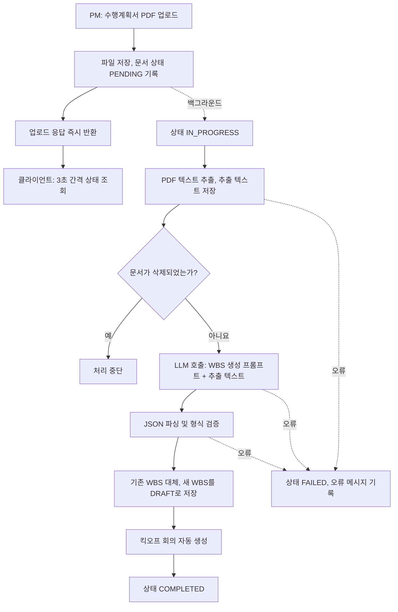
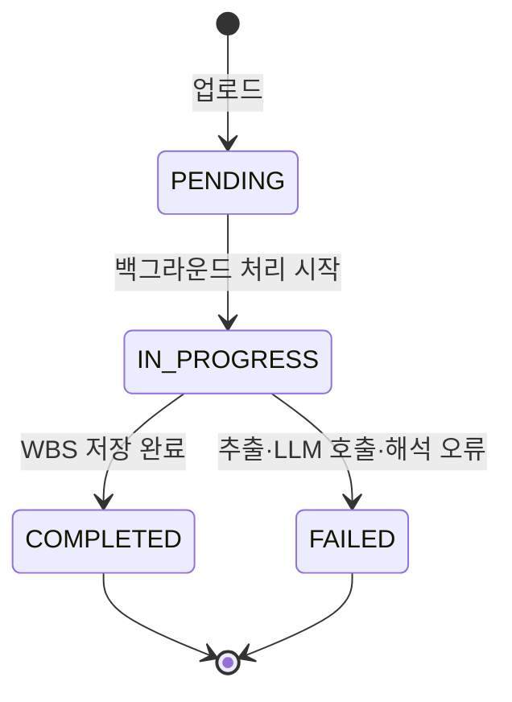
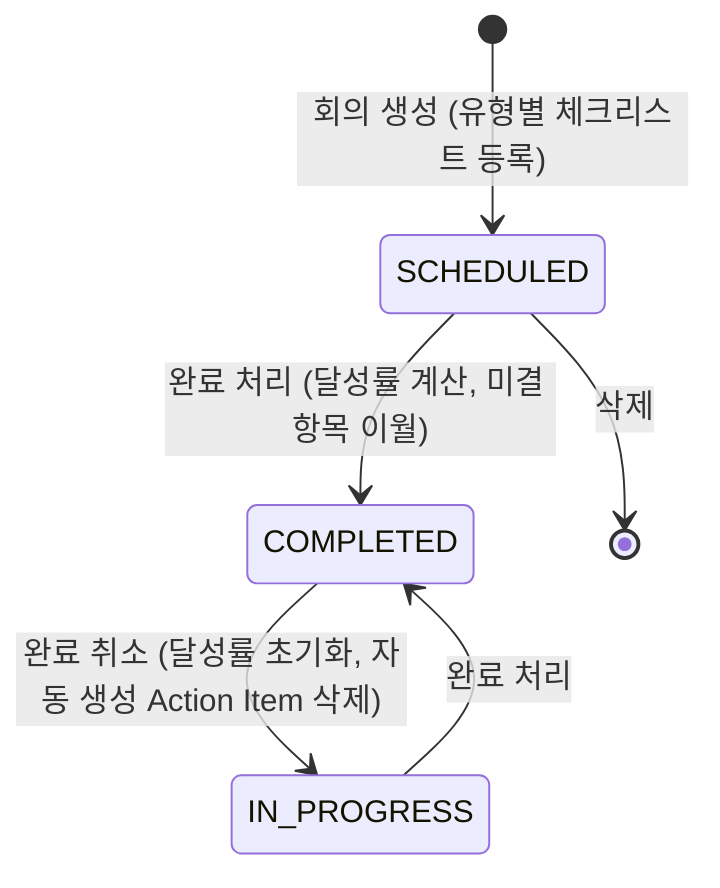

# 4. 핵심 기능 구현

본 장에서는 3장의 설계를 바탕으로 구현한 컨펌의 핵심 기능을 기술한다. 먼저 수행계획서로부터 WBS를 자동으로 생성하는 과정을 설명하고, 이어서 확정된 WBS를 바탕으로 회의를 추천하고 생성하는 기능, 회의 진행과 후속 조치를 돕는 회의 어시스트 기능, 일정 시각화 기능을 차례로 다룬다. 마지막으로 이 기능들을 사용자에게 제공하는 화면 구성을 설명한다. 각 기능은 처리 흐름, 핵심 설계 결정과 그 이유, 구현 방법의 순서로 서술한다.

## 가. WBS 자동 생성

WBS 자동 생성은 PM이 업로드한 수행계획서를 분석하여 부서별 태스크, 기간, 선후행 관계를 갖춘 WBS 초안을 만드는 기능으로, 컨펌의 가장 핵심적인 기능이다. 전체 처리 흐름은 [그림 4]와 같다. 처리는 크게 문서 업로드, 텍스트 추출, LLM을 이용한 WBS 생성, 결과 저장의 네 단계로 이루어지며, 텍스트 추출 이후의 단계는 사용자 요청과 분리되어 백그라운드에서 수행된다.

[그림 4 삽입: WBS 자동 생성 처리 흐름 / 흐름도. 아래 Mermaid 초안을 바탕으로 작성]



[그림 4] WBS 자동 생성 처리 흐름

### 1) 수행계획서 업로드 및 텍스트 추출

PM은 프로젝트의 WBS 화면에서 수행계획서 PDF 파일을 선택하거나 업로드 영역으로 끌어다 놓아 업로드한다. 서버는 multipart/form-data 형식으로 받은 파일을 메모리에서 읽어 서버의 업로드 디렉터리에 저장한다. 같은 이름의 파일이 여러 번 업로드되어도 서로 덮어쓰지 않도록, 저장 파일명 앞에 업로드 시각을 붙인다.

구현 과정에서 한글 파일명이 깨지는 문제가 있었다. multipart 요청을 처리하는 라이브러리가 파일명을 Latin-1 문자 집합으로 해석하기 때문에, UTF-8로 인코딩된 한글 파일명이 잘못된 문자로 저장되었다. 이를 해결하기 위해 서버는 전달받은 파일명을 Latin-1 바이트로 되돌린 뒤 UTF-8로 다시 해석하여 원래 파일명을 복원한다. 같은 처리를 회의록 업로드에도 적용하였다.

텍스트 추출에는 pdf-parse 라이브러리를 사용한다. 이 방식은 PDF 내부의 텍스트 계층을 그대로 읽으므로 처리가 빠르고 외부 서비스가 필요 없다. 다만 OCR을 적용하지 않았기 때문에, 종이 문서를 스캔하여 만든 PDF처럼 텍스트 계층이 없는 문서에서는 텍스트를 얻을 수 없다. 또한 국내 공공·기업 문서에서 많이 쓰이는 HWP 형식은 현재 지원하지 않으므로, 사용자는 PDF로 변환하여 업로드해야 한다. 추출한 텍스트는 문서 테이블의 추출 텍스트 열에 저장하여, 분석 결과를 다시 확인하거나 재처리할 때 활용할 수 있도록 하였다.

### 2) 비동기 문서 처리 흐름

수행계획서 분석은 외부 LLM API의 응답을 기다려야 하므로 처리 시간이 길다. 이를 요청-응답 주기 안에서 처리하면 사용자가 결과를 받을 때까지 화면이 멈추고, 연결 시간 초과로 요청이 실패할 수 있다. 이에 따라 서버는 업로드한 파일과 문서 정보를 저장한 즉시 응답을 반환하고, 텍스트 추출과 WBS 생성은 응답 이후에 백그라운드 작업으로 수행한다. 백그라운드 작업은 Node.js의 이벤트 루프에서 현재 요청 처리가 끝난 뒤 실행되도록 예약하는 방식으로 구현하였으며, 별도의 작업 큐는 사용하지 않는다.

문서는 처리 단계에 따라 [그림 5]와 같이 상태가 바뀐다. 업로드 직후에는 대기(PENDING) 상태이며, 백그라운드 작업이 시작되면 처리 중(IN_PROGRESS) 상태가 된다. WBS 생성과 저장까지 끝나면 완료(COMPLETED) 상태가 되고, 텍스트 추출, LLM 호출, 결과 해석 중 어느 단계에서든 오류가 발생하면 실패(FAILED) 상태가 되며 오류 메시지가 함께 기록된다.

[그림 5 삽입: 수행계획서 처리 상태 전이 / 상태도. 아래 Mermaid 초안을 바탕으로 작성]



[그림 5] 수행계획서 처리 상태 전이

클라이언트는 대기 또는 처리 중 상태의 문서가 하나라도 있으면 3초 간격으로 문서 목록과 WBS를 다시 조회하고, 모든 문서가 완료 또는 실패 상태가 되면 조회를 멈춘다. 분석이 끝나면 별도의 조작 없이 WBS 표가 화면에 나타난다.

PM은 분석이 진행 중인 문서를 삭제하여 분석을 취소할 수 있다. 이때 문제가 되는 것은 이미 시작된 백그라운드 작업이다. 서버는 텍스트 추출을 마친 뒤 문서가 여전히 존재하는지 확인하고, 삭제되었으면 LLM 호출을 생략하고 작업을 끝낸다. LLM 호출 도중에 문서가 삭제된 경우에는 저장 직전에 다시 확인하여, 생성된 WBS를 문서와의 연결 없이 저장한다. 삭제된 문서를 참조하도록 저장하면 외래 키 제약을 위반하여 이미 비용을 들여 얻은 생성 결과까지 잃게 되기 때문이다.

### 3) WBS 생성 프롬프트 설계

WBS 생성 품질은 LLM에 전달하는 프롬프트에 크게 좌우된다. 본 연구에서는 LLM이 따라야 할 역할, 작업 단계, 출력 형식을 명확히 구분하기 위해 시스템 프롬프트를 XML 형식의 태그로 구조화하였다(Anthropic, n.d.-c). 시스템 프롬프트의 구성은 [표 9]와 같으며, 전문은 부록 1에 수록하였다. 수행계획서에서 추출한 텍스트는 사용자 메시지에 별도 태그로 감싸 전달하여, 지시문과 분석 대상 문서가 섞이지 않도록 하였다.

[표 9] WBS 생성 프롬프트 구성

| 구성 요소 | 내용 |
|---|---|
| 역할 정의 | IT 프로젝트 관리에 특화된 수석 PM으로서, 부서 간 병목이 없는 효율적이고 현실적인 WBS를 JSON으로 생성하는 것을 목표로 제시 |
| 1단계: 정보 추출 | 프로젝트 배경과 목표, 전체 기간, 기능 명세, 부서별 팀원 정보를 추출 |
| 2단계: 태스크 분할 | 기능 목록을 한 부서가 전담할 수 있는 최소 작업 단위로 분할 |
| 3단계: 일정 산정 | 선후행 관계, 난이도와 경력에 따른 기간 차등, 병렬 처리, 날짜 배정 기준을 적용하여 일정 산정 |
| 출력 스키마 | 프로젝트 정보와 태스크 목록의 JSON 구조, 각 필드의 의미와 작성 예시 |
| 출력 제약 | 스키마를 따르는 JSON 객체 하나만 출력하고 다른 텍스트는 포함하지 않도록 제한 |

작업 지시를 세 단계로 나눈 것은 사람이 WBS를 작성하는 순서를 따르게 하기 위함이다. 실제 PM은 문서를 읽고 범위와 자원을 파악한 뒤 작업을 나누고, 마지막으로 순서와 기간을 정한다. 한 번에 최종 결과를 요구하기보다 이 순서를 명시하면 앞 단계의 결과가 다음 단계의 근거가 된다. 이는 복잡한 과제에서 중간 추론 과정을 단계적으로 거치도록 유도하면 성능이 높아진다는 선행 연구의 결과를 WBS 작성에 적용한 것이다(Kojima et al., 2022; Wei et al., 2022).

#### 가) 프로젝트 정보 추출 단계

첫 단계에서는 문서 전체에서 프로젝트 배경과 목표, 전체 수행 기간, 구현할 기능 목록, 부서별 팀원 정보(부서, 직급, 경력, 역할)를 추출하도록 하였다. 수행계획서마다 작성 형식이 달라 팀원 정보가 빠져 있거나 부족한 경우가 있으므로, 이때는 일반적인 IT 프로젝트의 표준 구성인 기획, 디자인, 프론트엔드, 백엔드 역할을 가정하여 초안을 만들도록 지시하였다. 이렇게 추출하거나 가정한 팀 구성은 이후 PM이 화면에서 확인하고 수정할 수 있다.

#### 나) 태스크 분할 단계

두 번째 단계에서는 추출한 기능 목록을 실제로 수행할 수 있는 최소 단위의 태스크로 나누도록 하였다. 이때 각 태스크는 기획, 디자인, 개발 등 특정 부서 하나가 전담할 수 있어야 한다는 조건을 두었다. 하나의 태스크에 여러 부서가 섞이면 담당이 불분명해지고 부서 간 선후행 관계를 표현할 수 없기 때문이다.

#### 다) 의존성 기반 일정 산정 단계

세 번째 단계에서는 분할한 태스크의 일정을 산정하도록 하였으며, 다음 네 가지 기준을 엄격히 적용하도록 지시하였다. 첫째, 선행 작업이 끝나야 후행 작업을 시작할 수 있도록 선후행 관계를 지킨다. 예를 들어 기획 부서의 기능 명세가 끝나야 디자인 부서의 화면 설계를 시작하고, 그 뒤에 프론트엔드 개발을 시작한다. 둘째, 전체 기간을 태스크 수로 균등하게 나누지 않고 작업의 난이도와 담당자의 경력을 고려하여 간단한 작업은 1~2일, 복잡한 작업은 5~10일처럼 기간을 차등 배정한다. 셋째, 서로 의존하지 않는 태스크는 같은 기간에 병렬로 배치하여 인력의 유휴 시간을 줄인다. 넷째, 태스크마다 시작일과 종료일을 정하되, 문서에 구체적인 날짜가 없으면 프로젝트 시작일을 기준으로 한 상대 일자(D+N)를 사용할 수 있게 하였다.

LLM은 태스크마다 식별자, 이름, 담당 부서, 복잡도, 기간, 시작일, 종료일, 선행 태스크 목록과 함께 기간과 배정의 근거를 서술한 추론 내용(reasoning)을 출력한다. 근거를 함께 출력하게 한 것은 PM이 자동 생성 결과를 그대로 받아들이지 않고 검토할 수 있도록 하기 위함이다. 자동 생성된 일정이 왜 그렇게 배치되었는지 알 수 없으면 PM은 결과를 신뢰하기 어렵고, 수정이 필요한 부분도 찾기 어렵다.

서버는 LLM의 응답에서 코드 블록 표시를 제거한 뒤 JSON으로 해석하고, 태스크 목록이 배열 형태인지 검증한다. 검증을 통과한 결과는 [표 10]과 같이 데이터베이스에 저장된다. 프로젝트에 이미 WBS가 있으면 이를 삭제하고 새 WBS로 대체하며, 새 WBS는 초안(DRAFT) 상태로 저장된다.

[표 10] WBS 생성 결과의 저장 대응

| LLM 출력 필드 | 저장 위치 | 비고 |
|---|---|---|
| 프로젝트 배경 및 목표 요약 | project_wbs.project_summary | WBS 화면 상단에 표시 |
| 전체 수행 기간 | project_wbs.total_duration | 문자열 그대로 저장 |
| 팀 구성(부서, 역할, 경력) | project_wbs.team_resources | JSONB 배열 |
| 태스크 식별자 | wbs_items.task_id | 예: T01 |
| 태스크명 | wbs_items.title | |
| 담당 부서 | wbs_items.assigned_role, phase | 두 열에 같은 값 저장 |
| 복잡도 | wbs_items.complexity | High, Medium, Low |
| 기간(일) | wbs_items.duration_days | |
| 시작일, 종료일 | wbs_items.start_date, end_date | 상대 일자(D+N)는 빈 값으로 저장 |
| 선행 태스크 목록 | wbs_items.dependencies | 태스크 식별자 목록 |
| 산정 근거 | wbs_items.reasoning | 수정 화면에 표시 |
| (출력 순서) | wbs_items.order | 1부터 차례로 부여 |
| (없음) | wbs_items.is_decision_point | 거짓(false)으로 초기화 |

현재 구현은 상대 일자(D+N)를 실제 날짜로 변환하지 않고 빈 값으로 저장한다. 따라서 문서에 구체적인 날짜가 없어 LLM이 상대 일자를 출력한 태스크는 PM이 날짜를 직접 입력하기 전까지 간트 차트와 캘린더에 표시되지 않는다. 프로젝트 시작일을 기준으로 상대 일자를 실제 날짜로 변환하는 처리는 향후 개선이 필요하다.

### 4) LLM 호출 안정화

공개 LLM API는 호출량 제한을 초과하거나 서버가 일시적으로 과부하 상태일 때 요청을 거부한다. WBS 생성은 사용자가 한 번 문서를 올리면 끝까지 처리되기를 기대하는 기능이므로, 일시적인 오류 한 번으로 분석이 실패하면 사용자는 같은 문서를 다시 올려야 한다. 이를 줄이기 위해 LLM 호출에 지수 백오프 재시도와 대체 모델 폴백을 적용하였다. 오류 유형별 처리 정책은 [표 11]과 같다.

[표 11] LLM 호출 오류 처리 정책

| HTTP 상태 코드 | 의미 | 같은 모델로 재시도 | 다음 모델로 폴백 |
|---|---|:---:|:---:|
| 429 | 호출량 제한 초과 | ○ | ○ |
| 500 | 서버 내부 오류 | ○ | ○ |
| 503 | 서버 과부하 | ○ | ○ |
| 404 | 모델을 찾을 수 없음 | × | ○ |
| 그 밖의 오류 | 요청 형식 오류, 인증 오류 등 | × | × |

#### 가) 지수 백오프 재시도

429, 500, 503 오류는 시간이 지나면 해소될 가능성이 높은 일시적 오류로 보고, 같은 모델로 최대 3회 다시 시도한다. 최초 호출을 포함하면 한 모델에 최대 4회까지 요청한다. 재시도 사이의 대기 시간은 식 (1)과 같이 시도할 때마다 두 배로 늘린다.

```text
t_n = 1000 × 2^n (ms),   n = 0, 1, 2          ··· (1)
```

즉 첫 번째 재시도 전에 1초, 두 번째 재시도 전에 2초, 세 번째 재시도 전에 4초를 기다린다. 대기 시간을 점차 늘리면 서버가 과부하에서 회복할 시간을 주면서, 짧은 간격으로 요청을 반복하여 과부하를 키우는 것을 피할 수 있다. 요청 형식 오류나 인증 오류처럼 다시 시도해도 결과가 같은 오류는 재시도하지 않고 즉시 실패로 처리한다.

#### 나) 대체 모델 폴백

같은 모델로 재시도를 모두 소진하였거나 모델 자체를 찾을 수 없는 경우(404)에는, 미리 정한 후보 목록의 다음 모델로 넘어가 같은 요청을 다시 보낸다. 후보 목록은 환경 변수로 지정한 기본 모델(지정하지 않으면 Gemini 2.5 Flash)을 첫 번째로 두고, Gemini 2.0 Flash, Gemini Flash 최신 버전, Gemini 1.5 Flash 순으로 구성하며, 중복된 모델은 제외한다. 특정 모델에 요청이 몰려 과부하가 지속되거나 모델이 지원 종료된 경우에도 다른 모델로 분석을 이어 갈 수 있다. 기본 모델이 아닌 모델로 성공하면 이를 경고 로그로 남겨, 운영자가 폴백 발생 빈도를 확인할 수 있게 하였다. 재시도와 폴백을 결합한 호출 과정을 의사코드로 나타내면 다음과 같다.

```text
for model in [기본 모델, 대체 모델 1, 대체 모델 2, ...]:
    for attempt in 0..3:
        try: return 호출(model)
        catch 오류:
            if 오류 ∈ {429, 500, 503} and attempt < 3: 대기(1000 × 2^attempt ms); continue
            if 오류 ∈ {429, 500, 503, 404}: break      # 다음 모델로
            throw 오류                                # 즉시 실패
throw 마지막 오류
```

이 재시도와 폴백 처리는 공통 LLM 모듈 안에 구현되어 WBS 생성과 회의 추천에 똑같이 적용된다. 다른 모듈은 "WBS 생성", "회의 추천"과 같은 기능 단위 메서드만 호출하고 어떤 공급자와 모델이 사용되는지는 알지 못한다. 실제로 서버에는 Claude API를 호출하는 구현이 함께 작성되어 있으며, 공통 LLM 모듈 내부만 바꾸면 공급자를 전환할 수 있다.

### 5) WBS 검토·수정 및 확정

자동 생성된 WBS는 초안이며, PM의 검토를 거쳐 확정된다. 검토는 팀 구성 확인, 태스크 수정, 확정의 세 단계로 이루어진다.

먼저 PM은 WBS 화면 상단의 팀 구성 패널에서 LLM이 수행계획서에서 인식한 부서, 역할, 경력 정보를 확인하고 수정한다. 문서에서 팀 구성을 인식하지 못한 경우에는 PM이 필요한 부서와 역할을 직접 입력하도록 안내한다. 다음으로 PM은 WBS 표에서 태스크를 검토한다. 표는 식별자, 태스크명, 부서, 복잡도, 기간, 시작일, 종료일 열과 의사결정 지점을 표시하는 확인 열, 삭제 열로 구성되며, 앞의 일곱 열을 기준으로 정렬할 수 있다. 태스크명을 누르면 수정 창이 열리고, 태스크명, 부서, 기간, 시작일, 종료일, 의사결정 지점 여부를 수정할 수 있다. 수정 창에는 LLM이 제시한 산정 근거가 함께 표시되어, PM이 근거를 보고 일정을 조정할 수 있다. 불필요한 태스크는 개별로 삭제하거나 WBS 전체를 삭제할 수 있다.

태스크를 삭제하면 남은 태스크의 순번과 표시 식별자(T01, T02, …)를 1부터 다시 매겨 빈 번호가 생기지 않도록 하였다. 다만 다른 태스크의 선행 태스크 목록에 기록된 식별자는 함께 갱신하지 않으므로, 삭제 후에는 선행 관계 표기와 식별자가 어긋날 수 있다. 이는 향후 보완이 필요한 부분이다.

검토가 끝나면 PM은 WBS를 확정한다. 확정하면 WBS의 상태가 초안(DRAFT)에서 확정(CONFIRMED)으로 바뀌고, 확정 일시와 확정한 사용자가 기록된다. 확정된 WBS는 회의 추천의 입력으로 사용된다. 현재 구현은 확정 이후에도 태스크 수정을 허용하며, 확정 시점의 일정을 별도로 보관하지는 않는다.

## 나. WBS 기반 회의 추천

WBS가 만들어지면 그 일정에 맞추어 회의를 계획해야 한다. 컨펌은 이를 돕기 위해 세 가지 기능을 제공한다. PM이 WBS에서 의사결정이 필요한 태스크를 표시하는 기능, 확정된 WBS를 LLM이 분석하여 회의 일정을 추천하는 기능, WBS 생성 직후 킥오프 회의를 자동으로 만드는 기능이다.

### 1) 의사결정 지점 지정

프로젝트에는 설계 확정이나 산출물 검수처럼 관계자의 의사결정이 있어야 다음 단계로 넘어갈 수 있는 시점이 있다. 컨펌은 이러한 시점을 WBS 태스크의 의사결정 지점 속성으로 표현한다. WBS를 생성할 때는 모든 태스크의 의사결정 지점 속성을 거짓으로 두고, 어떤 태스크를 의사결정 지점으로 볼지는 PM이 정하도록 하였다. PM은 WBS 표의 확인 열에서 체크 상자를 누르거나 태스크 수정 창에서 의사결정 지점을 지정한다.

지정된 의사결정 지점은 화면에서 일반 태스크와 구별되어 표시된다. 간트 차트에서는 기간 막대 대신 마름모(◆) 표식으로, 캘린더에서는 별도의 색으로, 부서별 보기에서는 '의사결정' 표시로 나타나며, 프로젝트 개요 화면에는 의사결정 지점의 개수가 표시된다. 이를 통해 PM과 팀원은 프로젝트 일정 가운데 어느 시점에 결정이 필요한지를 한눈에 파악할 수 있다.

### 2) 회의 추천 프롬프트 설계

회의 추천은 확정된 WBS가 있을 때만 요청할 수 있으며, 확정된 WBS가 없으면 서버는 요청을 거부한다. 서버는 WBS의 프로젝트 요약, 전체 기간, 그리고 각 태스크의 부서, 태스크명, 시작일, 종료일을 한 줄씩 나열한 텍스트를 만들어 LLM에 전달한다. 회의 추천 프롬프트는 WBS 생성 프롬프트와 같은 방식으로 역할 정의, 추천 기준, 출력 스키마를 태그로 구분하였으며, 전문은 부록 2에 수록하였다. 회의 유형별 추천 기준은 [표 12]와 같다.

[표 12] 회의 유형별 추천 기준

| 회의 유형 | 추천 기준 |
|---|---|
| 킥오프(KICKOFF) | 프로젝트 착수 시점(가장 이른 시작일 무렵)에 1회 |
| 진도 점검(PROGRESS_CHECK) | 개발·구현처럼 긴 단계가 진행되는 동안 2~3주 간격으로 |
| 이슈 체크(ISSUE_CHECK) | 부서 간 의존성이 몰리거나 일정이 빠듯한 구간 직전 |
| 합의(CONSENSUS) | 설계 확정, 산출물 검수, 배포 승인 등 의사결정이 필요한 핵심 분기 직전 |

이와 함께 회의가 지나치게 많아지지 않도록 프로젝트 규모에 맞추어 3~6개 정도를 추천하게 하고, 추천 일자는 관련 작업 시작 2~3일 전처럼 현실적인 날짜로 정하도록 하였다. LLM은 회의마다 제목, 유형, 추천 일자, 추천 근거, 관련 단계를 출력한다. 서버는 회의 유형 값을 대문자로 정규화한 뒤 네 가지 유형에 속하지 않는 항목은 제외한다. 추천 결과 가운데 등록할 회의를 일괄 등록 API로 보내면, 서버는 일반 회의 생성과 같은 과정으로 여러 회의를 한 번에 생성한다. 따라서 추천으로 만든 회의에도 유형별 체크리스트가 그대로 적용된다.

현재 회의 추천 입력에는 PM이 지정한 의사결정 지점 정보가 포함되지 않는다. LLM은 태스크명과 일정만 보고 의사결정이 필요한 분기를 추론하여 합의 회의를 추천한다. PM이 지정한 의사결정 지점을 추천 입력에 포함하면 합의 회의의 추천 시점을 더 정확하게 정할 수 있을 것으로 기대되며, 이는 향후 개선 과제로 남긴다. 또한 회의 추천과 추천 회의 일괄 등록은 서버 API로 구현되어 있으나 현재 사용자 화면에는 연결되어 있지 않다. [TODO: 회의 추천 화면 연동 여부 확인 후 서술 수정]

### 3) 킥오프 회의 자동 생성

킥오프 회의는 모든 프로젝트에서 반드시 열리는 회의이므로, 추천을 거치지 않고 WBS 생성 직후 자동으로 만든다. 서버는 WBS를 저장한 뒤 해당 프로젝트에 킥오프 회의가 이미 있는지 확인하고, 없을 때만 새로 생성한다. 문서를 다시 업로드하여 WBS를 재생성하더라도 킥오프 회의가 중복으로 생기지 않게 하기 위함이다. 회의 일시는 WBS 태스크 가운데 가장 이른 시작일로 정하고, 날짜가 있는 태스크가 없으면 생성 시점으로 정한다. 회의에는 킥오프 회의의 기본 체크리스트가 함께 등록된다.

킥오프 회의 생성은 WBS 생성의 부가 기능이므로, 생성 과정에서 오류가 발생하더라도 경고 로그만 남기고 WBS 생성 결과는 정상적으로 반환한다.

## 다. 회의 어시스트

회의 어시스트는 회의 전 준비, 회의 중 진행, 회의 후 후속 조치를 지원하는 기능이다. 회의는 [그림 6]과 같이 예정, 완료, 진행 중의 상태를 가지며, 회의 완료 처리를 기준으로 달성률 계산과 Action Item 이월이 일어난다.

[그림 6 삽입: 회의 상태 전이 / 상태도. 아래 Mermaid 초안을 바탕으로 작성]



[그림 6] 회의 상태 전이

### 1) 회의 유형별 체크리스트 생성

회의를 생성할 때 사용자는 회의 제목, 유형, 일시와 함께 관련 부서를 선택한다. 관련 부서는 WBS에 등장하는 부서 가운데 여러 개를 고를 수 있으며, 캘린더에서 회의를 부서 색으로 표시하는 데 사용된다. 회의가 생성되면 서버는 회의 유형에 맞는 기본 체크리스트를 자동으로 등록한다. 유형별 기본 체크리스트는 [표 13]과 같다.

[표 13] 회의 유형별 기본 체크리스트

| 순서 | 킥오프 | 진도 점검 | 이슈 체크 | 합의 |
|:---:|---|---|---|---|
| 1 | 프로젝트 목표 및 범위 공유 | 지난 기간 진행 상황 보고 | 이슈 현황 보고 | 의사결정 배경 및 목적 공유 |
| 2 | 팀원 역할 및 책임 명확화 | 현재 진행 중인 작업 현황 | 이슈 원인 분석 | 관련 데이터 및 근거 검토 |
| 3 | 일정 및 마일스톤 확인 | 미완료 Action Item 점검 | 해결 방안 논의 | 대안 비교 분석 |
| 4 | 커뮤니케이션 채널 결정 | 일정 지연 이슈 확인 | 담당자 및 기한 결정 | 최종 결정 도출 |
| 5 | WBS 검토 및 승인 | 다음 기간 계획 수립 | 에스컬레이션 필요 여부 확인 | 후속 조치 계획 수립 |

기본 체크리스트는 각 회의 유형이 반드시 다루어야 할 안건을 정리한 것이다. 예를 들어 진도 점검 회의에는 미완료 Action Item 점검 항목이 있어, 앞선 회의에서 넘어온 미결 사항을 빠뜨리지 않고 확인하게 한다. 기획 단계에서는 LLM이 회의마다 체크리스트 초안을 생성하도록 계획하였으나, 현재 구현은 유형별 표준 템플릿을 사용한다. 템플릿 방식은 LLM 호출 없이 즉시 체크리스트를 제공하고 회의 유형 사이의 형식을 일정하게 유지한다는 장점이 있다.

팀원은 회의 전에 체크리스트 항목을 추가, 수정, 삭제하여 실제 안건에 맞게 조정하고, 회의 중에는 논의를 마친 항목을 완료로 표시한다. 체크리스트 수정 요청은 항목 전체를 한 번에 보내고 서버가 기존 항목을 모두 교체하는 방식으로 처리하여, 항목의 추가, 삭제, 순서 변경을 하나의 요청으로 반영한다. 회의가 완료되면 화면에서 체크리스트를 더 이상 수정할 수 없다.

### 2) 회의 브리핑과 미결 Action Item 이월

회의에서 결정한 후속 조치가 다음 회의까지 이어지지 않으면 같은 논의가 반복된다. 컨펌은 이를 막기 위해 회의를 완료할 때 처리하지 못한 사항을 Action Item으로 남기고, 다음 회의에서 이를 다시 보여 준다.

PM이 회의를 완료 처리하면 서버는 두 가지 작업을 수행한다. 먼저 해당 프로젝트에서 아직 완료되지 않은 기존 Action Item을 모두 이월 항목으로 표시한다. 다음으로 이번 회의의 체크리스트 가운데 완료로 표시되지 않은 항목을 같은 제목의 새 Action Item으로 생성한다. 이렇게 생성된 Action Item에는 원래 회의의 식별자가 기록되며, 담당자와 마감일은 비워 두어 PM이 이후에 지정하도록 하였다.

회의 브리핑 API는 현재 회의보다 앞선 일정의 회의 가운데 가장 최근에 완료된 회의의 제목, 일시, 달성률, 완료하지 못한 체크리스트 항목과 함께, 프로젝트에서 이월된 미완료 Action Item 목록을 반환한다. 회의 상세 화면의 개요에는 이 가운데 이월된 Action Item 목록이 '이월' 표시와 함께 나타나, 참석자는 회의를 시작하기 전에 지난 회의에서 넘어온 과제를 확인할 수 있다. 직전 회의의 정보는 현재 화면에 표시하지 않는다.

회의를 실수로 완료 처리한 경우를 위해 완료 취소 기능을 두었다. PM이 완료를 취소하면 회의는 진행 중 상태로 바뀌고 달성률과 완료 일시가 지워지며, 완료 처리 때 체크리스트로부터 자동 생성했던 Action Item이 삭제된다. 서버는 회의 식별자가 일치하고 마감일이 없는 Action Item을 자동 생성 항목으로 판단한다. PM이 직접 등록하는 Action Item은 담당자와 마감일을 반드시 입력해야 하므로, 마감일의 유무로 두 종류를 구별할 수 있다. 다만 완료 처리 때 기존 Action Item에 붙인 이월 표시는 완료를 취소해도 되돌리지 않는다.

Action Item은 프로젝트의 Action Item 화면에서 관리한다. PM은 제목, 담당자, 마감일을 지정하여 Action Item을 직접 등록할 수 있고, 팀원은 항목의 완료 여부를 바꿀 수 있다. 항목을 완료로 바꾸면 서버가 완료 일시와 처리한 사용자를 기록하고, 다시 미완료로 바꾸면 이 기록을 지운다.

### 3) 체크리스트 달성률 산출

회의가 계획한 안건을 얼마나 다루었는지를 나타내기 위해 체크리스트 달성률을 계산한다. 달성률은 회의를 완료 처리하는 시점에 식 (2)와 같이 계산하여 회의 정보에 저장한다.

```text
A = round( N_done / N_total × 100 )   (N_total > 0)
A = 0                                  (N_total = 0)            ··· (2)
```

여기서 N_total은 회의의 전체 체크리스트 항목 수이고, N_done은 완료로 표시된 항목 수이며, A는 백분율 단위의 달성률이다. 달성률은 회의 상세 화면의 개요와 결과 화면에 표시되며, 결과 화면에서는 완료 항목 수와 전체 항목 수, 완료 일시, 항목별 완료 여부를 함께 보여 준다. 또한 브리핑 API가 직전 회의의 달성률을 함께 반환하므로, 회의 사이의 운영 흐름을 이어서 확인하는 데 활용할 수 있다.

### 4) 회의록 관리

기획 단계에서는 회의 음성을 녹음하여 텍스트로 변환하고 체크리스트 이행 여부를 자동으로 검증하는 기능을 계획하였다. 그러나 본 연구에서는 이 기능의 구현을 보류하고, 대신 사용자가 작성한 회의록 파일을 회의에 첨부하는 기능을 구현하였다. 음성 변환 관련 코드와 데이터베이스 필드는 이후 재사용을 위해 비활성화된 상태로 남겨 두었다.

회의록은 회의 상세 화면의 회의록 탭에서 파일을 끌어다 놓거나 선택하여 업로드한다. 업로드할 수 있는 형식은 HWP, DOC, DOCX, PDF이며, 서버는 파일 확장자를 검사하여 그 밖의 형식은 거부한다. 회의록 파일은 수행계획서와 달리 서버 디스크가 아닌 데이터베이스에 원본 파일명, MIME 형식, 크기와 함께 저장한다. 배포 환경의 디스크는 서버를 다시 시작하면 초기화될 수 있으므로, 회의 기록처럼 오래 보관해야 하는 파일은 데이터베이스에 두는 편이 안전하기 때문이다. 파일 본문은 회의 정보를 조회할 때 함께 읽지 않고, 내려받기를 요청할 때만 읽어 원래 파일명과 형식으로 전달한다.

## 라. 일정 시각화

WBS와 회의 일정은 여러 관점에서 확인할 수 있어야 한다. 태스크 하나하나를 검토할 때는 표가, 전체 일정의 흐름과 겹침을 볼 때는 간트 차트가, 날짜별로 무엇이 있는지 볼 때는 캘린더가 적합하다. 컨펌은 WBS에 대해 표, 간트 차트, 부서별 보기를 제공하고, 프로젝트 개요에서는 WBS 일정과 회의를 합친 캘린더를 제공하여 계획과 회의 일정을 서비스 안에서 한 번에 확인할 수 있게 한다.

WBS 화면에서는 표, 차트, 부서별 보기 가운데 하나를 선택할 수 있다. 표 보기는 가절 5)에서 설명한 바와 같이 태스크를 검토하고 수정하는 데 쓰인다. 부서별 보기는 태스크를 담당 부서별로 묶어 보여 주며, 부서마다 태스크 수와 기간의 합계를 표시하여 업무가 특정 부서에 몰리지 않았는지 확인할 수 있게 한다.

간트 차트는 [그림 7]과 같이 태스크를 시작일 순서로 한 행씩 배치하고, 시작일부터 종료일까지를 가로 막대로 표시한다. 가로축은 하루를 10픽셀로 환산하며 월 경계마다 세로 구분선을 둔다. 막대의 색은 부서에 따라 정해지는데, 부서가 처음 등장한 순서대로 6가지 색의 팔레트에서 색을 배정한다. 의사결정 지점으로 지정된 태스크는 막대 대신 시작일 위치에 마름모 표식으로 나타낸다. 막대나 표식을 누르면 표 보기와 같은 태스크 수정 창이 열린다. 시작일이나 종료일이 없는 태스크는 차트에 배치할 수 없으므로 제외한다.

[그림 7 삽입: WBS 간트 차트 화면 / 화면 캡처. 부서별 색 막대와 의사결정 지점 마름모 표식이 보이도록 캡처]

[그림 7] WBS 간트 차트 화면

프로젝트 개요 화면의 캘린더는 [그림 8]과 같이 월요일부터 시작하는 월간 달력에 WBS 태스크와 회의를 함께 표시한다. 여러 날에 걸친 태스크는 주 단위로 잘라 날짜 칸을 가로지르는 막대로 그린다. 한 주에 여러 태스크가 겹치면 막대를 여러 줄(lane)에 나누어 배치해야 하는데, 이를 위해 그 주에 걸친 태스크를 시작일 순으로, 시작일이 같으면 기간이 긴 순으로 정렬한 뒤, 각 태스크를 겹치지 않는 첫 번째 줄에 배치하는 탐욕적(greedy) 방식을 사용하였다. 한 주에 표시하는 줄은 최대 4개로 제한하고, 넘치는 태스크는 개수로만 표시하여 달력 칸이 지나치게 커지지 않도록 하였다. 태스크 막대는 부서 색으로, 의사결정 지점은 별도의 보라색으로 칠한다. 회의는 해당 날짜 칸에 회의 유형과 제목으로 표시하며, 관련 부서의 색 표시를 붙인다. 하루에 회의가 3개 이상이면 2개만 보이고 나머지는 개수로 표시한다. 회의를 누르면 해당 회의의 상세 화면으로 이동한다.

[그림 8 삽입: 프로젝트 캘린더 화면 / 화면 캡처. WBS 태스크 막대, 의사결정 지점, 회의 표시가 함께 보이는 달을 캡처]

[그림 8] 프로젝트 캘린더 화면

간트 차트와 캘린더는 별도의 차트 라이브러리를 사용하지 않고 React 구성 요소로 직접 구현하였다. 의사결정 지점의 마름모 표식, 부서 색 배정, 주 단위 막대 분할처럼 컨펌에 필요한 표현을 자유롭게 구현할 수 있고, 클라이언트가 내려받는 코드의 크기도 줄일 수 있기 때문이다.

## 마. 사용자 인터페이스

컨펌의 클라이언트는 국내 협업 도구인 네이버웍스의 화면 구성을 참고하여 왼쪽 메뉴와 오른쪽 작업 영역으로 이루어진 배치를 사용하였다. 협업 도구 사용자에게 익숙한 배치를 따라 처음 사용하는 사용자도 쉽게 적응할 수 있게 하기 위함이다. 주요 화면의 구성은 [표 14]와 같다.

[표 14] 화면 구성

| 화면 | 구성 | 주요 기능 |
|---|---|---|
| 로그인 | – | 구글 계정 로그인 |
| 프로젝트 목록 | – | 참여 중인 프로젝트 목록 조회, 프로젝트 생성 |
| 프로젝트 상세 | 개요 | 프로젝트 정보, WBS 일정과 회의를 합친 캘린더, WBS 현황, 부서 구성 |
| | WBS | 수행계획서 업로드, 팀 구성 확인, WBS 표·차트·부서별 보기, 태스크 수정·삭제, 의사결정 지점 지정, WBS 확정 |
| | 회의 | 회의 목록, 회의 생성(유형, 일시, 관련 부서) |
| | 팀원 | 팀원 목록, 이메일 검색으로 팀원 등록, 역할 관리 |
| | Action Items | Action Item 목록, 등록, 완료 상태 전환 |
| 회의 상세 | 개요 | 회의 정보, 달성률, 이월된 Action Item, 완료 처리·완료 취소 |
| | 체크리스트 | 체크리스트 편집과 완료 표시 |
| | 회의록 업로드 | 회의록 파일 업로드·내려받기 |
| | 결과 | 달성률, 항목별 완료 여부, 회의록 (완료된 회의만) |
| 프로필 | – | 이름, 직군 등 내 정보 수정 |

사용자는 로그인 후 프로젝트 목록에서 프로젝트를 고르거나 새로 만든다. 프로젝트 상세 화면은 개요, WBS, 회의, 팀원, Action Items의 다섯 개 탭으로 구성되며, 프로젝트와 관련된 작업은 모두 이 화면 안에서 이루어진다. 회의를 누르면 회의 상세 화면으로 이동하며, 이 화면은 개요, 체크리스트, 회의록 업로드, 결과의 네 개 탭으로 구성된다. 결과 탭은 완료된 회의에서만 표시된다. 주요 화면은 [그림 9]와 같다.

[그림 9 삽입: 주요 화면 / 화면 캡처. (a) 프로젝트 목록, (b) 프로젝트 상세의 WBS 탭(표 보기와 팀 구성 패널), (c) 회의 상세의 개요 탭(달성률과 이월된 Action Item)]

[그림 9] 주요 화면

로그인이 필요한 화면은 접근 시 인증 상태를 확인하여, 로그인하지 않은 사용자는 로그인 화면으로 보낸다. 반대로 이미 로그인한 사용자가 로그인 화면에 접근하면 프로젝트 목록으로 보낸다. 앱을 처음 불러올 때 저장된 토큰이 있으면 서버의 내 정보 API를 호출하여 토큰이 유효한지 확인하며, 확인하는 동안에는 로딩 표시를 보여 준다. 이는 만료된 토큰으로 화면에 들어갔다가 로그인 화면으로 반복해서 이동하는 문제를 막기 위한 것이다.
